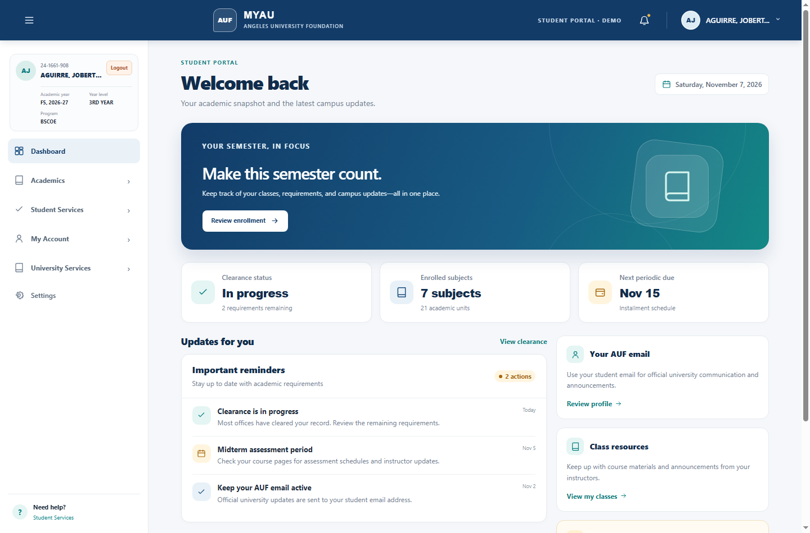

# MYAU Student Portal

A responsive, static React demonstration of a student portal for Angeles University Foundation (AUF). It presents fictional student records and simulated workflows for academic information, enrollment, clearance, student accounts, and campus services.

> This is a demonstration only. It does not connect to AUF systems, submit real documents, or process payments.



## Highlights

- Responsive login and portal shell with desktop sidebar and mobile navigation
- Dashboard notices, student clearance, personal information, and simulated submissions
- Enrollment, subject checklist, academic performance, awards, and OJT/field-work sections
- Student account ledger, periodic dues, fees, and online-payment information
- Standalone Documents, Library, Faculty Evaluation, and Online Payment pages
- Fictional demo data with browser session/local-storage persistence for safe interaction
- Accessible semantic controls, responsive tables, visible focus states, and reduced-motion support

## Technology

- React 19 with functional components and hooks
- React Router 7 for login, standalone pages, redirects, and hash-based portal sections
- Vite 7 for development and production builds
- Bootstrap 5 plus the custom MYAU design system in `css/styles.css`
- Node.js 20.19+ or 22.12+

## Run locally

```sh
npm install
npm run dev
```

Open the local URL printed by Vite. To create and preview a production build:

```sh
npm run build
npm run preview
```

The project currently has no automated test script; use the production build as the baseline verification command.

## Demo accounts

Use either account on the login screen:

| Username | Password | Use |
| --- | --- | --- |
| `DEMO` | `MYAUDEMO` | Recommended account with clearly fictional records |
| `AUFAGUIRRE15` | `08642QWE` | Sample student profile and records |

These credentials are intentionally stored in `src/data/demoAccounts.js` and must not be treated as real authentication secrets.

## Routes and page structure

The root route (`/` or `/login`) opens the sign-in screen. After sign-in, the portal is served from `/index.html`; portal sections are selected with hashes, for example `/index.html#dashboard` and `/index.html#student-clearance`.

Standalone pages are available at:

- `/pages/documents.html`
- `/pages/library.html`
- `/pages/faculty-evaluation.html`
- `/pages/online-payment.html`

The legacy `/pages/ebsco-database.html` entry point redirects to the combined Library page. The legacy `discipline-monitoring` hash redirects to Student Clearance.

## Source organization

- `src/App.jsx` defines application routes and legacy redirects.
- `src/data/mockData.js` contains shared page metadata, navigation, and fictional records.
- `src/data/demoAccounts.js` contains local demo profiles and account-specific sample data.
- `src/components/` contains the shared application shell and UI primitives.
- `src/pages/` contains portal feature modules and standalone page views.
- `src/hooks/` and `src/contexts/` contain browser persistence and student-profile state.
- `pages/` contains standalone HTML entry points; `public/` contains static assets.
- `docs/ui-foundation.md` records visual, accessibility, and implementation guidelines.

## Project notes

Keep the existing page/section structure intact when changing a feature. Enrollment, document, payment, and evaluation interactions are simulations, and uploaded file contents or payment credentials must never be persisted.
