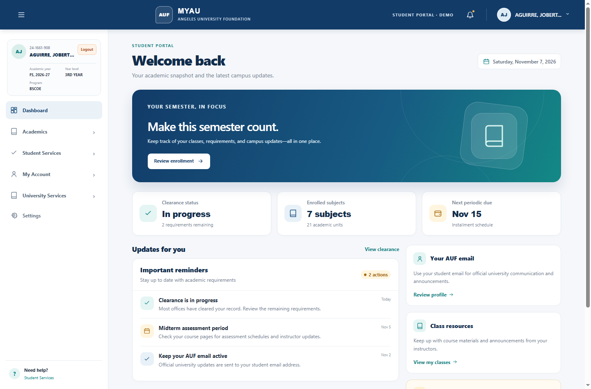
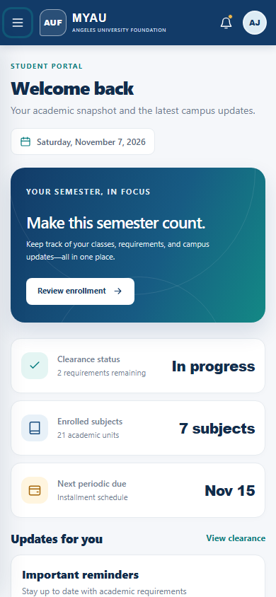

# MYAU Capstone Technical Documentation

## Project overview

MYAU (Modern Student Portal) is a responsive frontend concept for familiar student tasks: reviewing academics, managing a demo enrollment, tracking clearance, checking student account information, and accessing university services. The project is for the ELECT1 frontend capstone and is not an official Angeles University Foundation application.

## Problem statement and objectives

Student portal tasks can be difficult to scan when information is dense or navigation is inconsistent. This capstone demonstrates a clearer information hierarchy and responsive experience. Objectives:

- Provide a single, consistent navigation model across common student workflows.
- Present schedules, academic records, requirements, and account summaries clearly.
- Demonstrate accessible form validation, interactions, and feedback.
- Persist mock changes locally without requiring a backend or real integrations.

## Target users

The intended audience is AUF students evaluating a frontend portal concept. Every student record is fictional.

## Features

1. Dashboard with date, announcements, quick links, and computed student summaries.
2. Academic Records with semester details, search, grade sorting, and standing.
3. Class Schedule with course search and weekday filtering.
4. Enrollment with a searchable mock catalog and simulated add/drop actions.
5. Clearance requirement tracking with local submission status.
6. Student Profile editing with browser-local persistence and validation.
7. Payments with assessment breakdown, outstanding balance, history, and a simulated payment preview.
8. Library loan list, search, and renewal previews, with an external EBSCO link.
9. Faculty Evaluation form, validated submission, local history, and removal.
10. Settings for color theme, preferences, compact tables, and clearing local demo state.

## Technology stack

- HTML5 and CSS3
- JavaScript ES modules and React functional components/hooks
- Vite
- React Router
- Bootstrap base styles/utilities with the MYAU design system
- Browser `localStorage`; no backend, real account, or payment provider

## Architecture

- `src/App.jsx` defines route-to-module mapping.
- `src/components/AppLayout.jsx` provides the persistent header, navigation drawer/sidebar, student panel, and footer.
- `src/components/UI.jsx` provides page headings, panels, tables, feedback, status badges, stats, and dialogs.
- `src/pages/` contains one React component per functional module.
- `src/data/mockData.js` contains fictional student and academic records.
- `src/hooks/useLocalStorage.js` provides reusable local persistence.
- `css/styles.css` and `src/styles.css` define visual tokens, shared components, responsive rules, and dark mode.

## UI/UX and screenshots

The interface uses AUF-inspired navy and teal, neutral backgrounds, consistent card and form treatments, visible focus, mobile navigation, responsive tables, and status text in addition to color. For submission screenshots, run the app and capture:

- Dashboard at desktop width and mobile width (captured below).
- Academic Records showing the search/sort controls.
- Enrollment with the add-course confirmation dialog.
- Payments with its mock balance and payment preview.
- Settings in dark mode.

The browser-presentable capstone slide deck is [capstone-presentation.html](./capstone-presentation.html).

## Implementation and data handling

Run `npm install` and `npm run dev` for local development. `npm run build` outputs a static Vite bundle to `dist/`. Routes are client-side and a deployment host must rewrite unknown paths to `index.html`. Mock enrollment, clearance, profile, payments, book loans, evaluations, and preferences are stored in browser `localStorage`; clearing site storage resets the demo. No data leaves the browser.

## Testing

Run `npm run build` as the production compilation check. Manually verify all ten routes, sidebar groups, narrow viewport drawer, search and filter controls, enrollment add/drop, clearance status updates, profile validation/save, payment balance/history preview, library renewal, evaluation validation/create/delete, theme preferences, and the reset confirmation. Verify browser developer tools report no runtime errors and check that narrow layouts do not create page-level horizontal overflow.

## Deployment

Deploy the contents of `dist/` to a static host such as Netlify, Vercel, or GitHub Pages. Configure SPA fallback/rewrite routing for React Router. Deployment is not configured in this workspace; a hosting account and repository connection are required.

## Challenges and limitations

- No official API, identity provider, database, or payment integration is included.
- Browser `localStorage` is device/browser-specific and is not suitable for sensitive data.
- EBSCO is an external destination; institutional access is not verified by this demo.
- GitHub publishing, live deployment, screenshots, and presentation export require access or capture steps outside this local project.

## References

- React: https://react.dev/
- Vite: https://vite.dev/guide/
- React Router: https://reactrouter.com/
- Bootstrap: https://getbootstrap.com/docs/
- Angeles University Foundation: https://auf.edu.ph/
